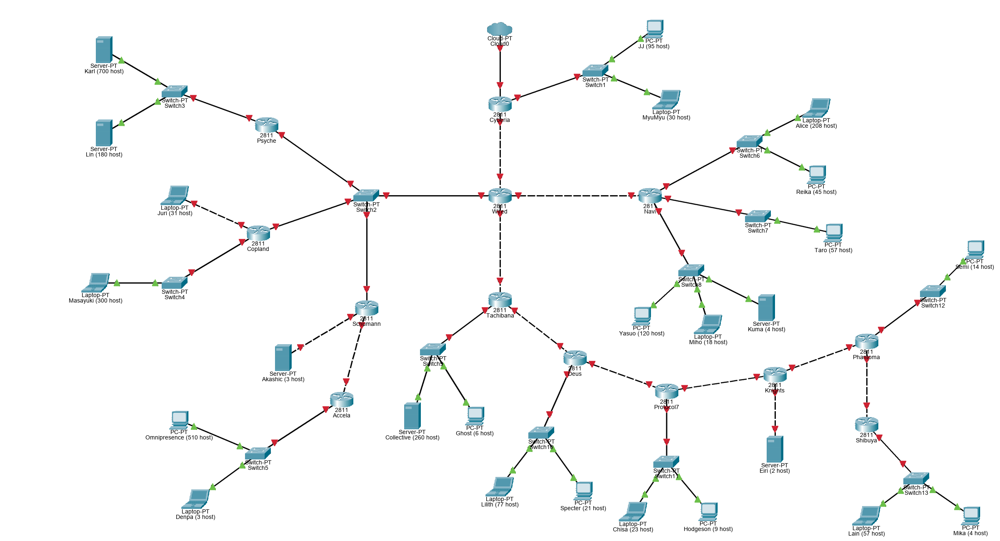
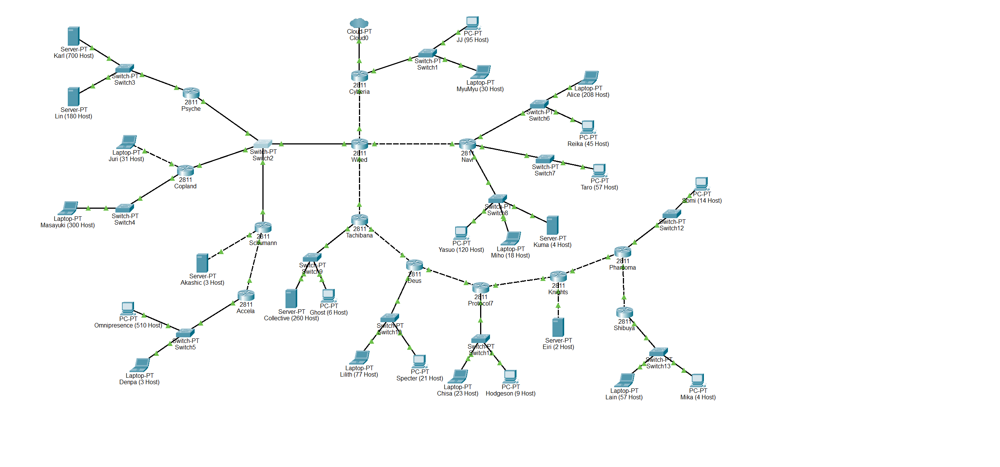
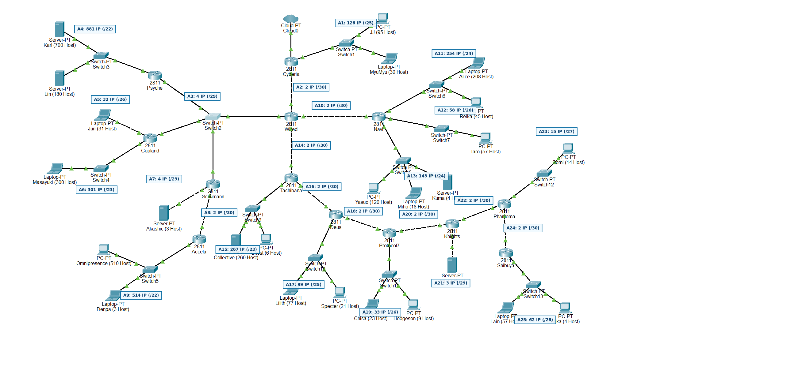
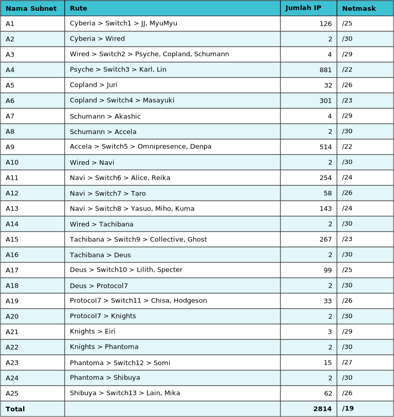
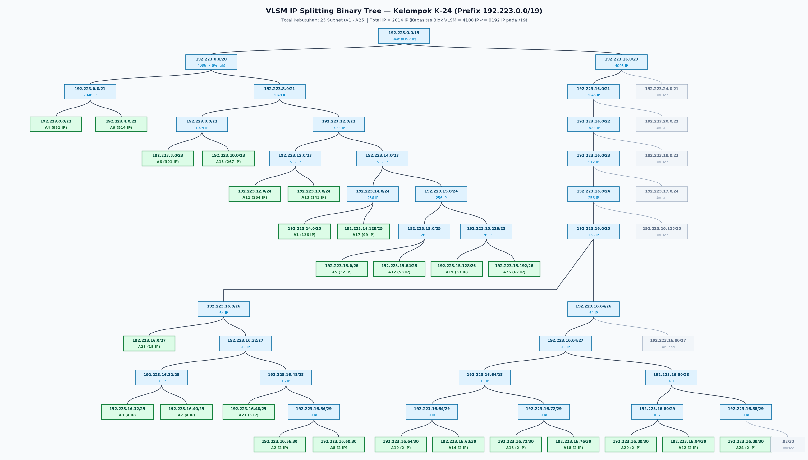
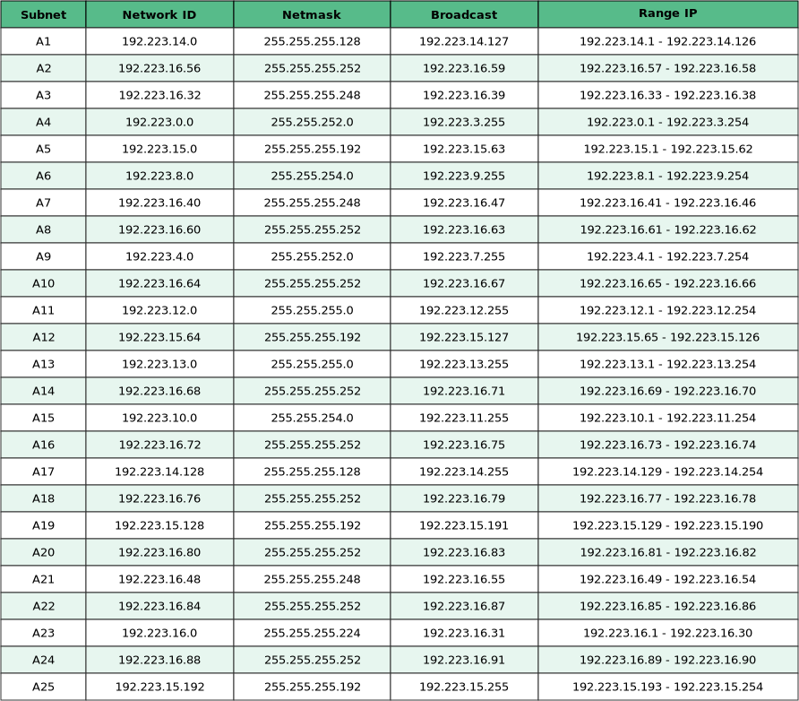
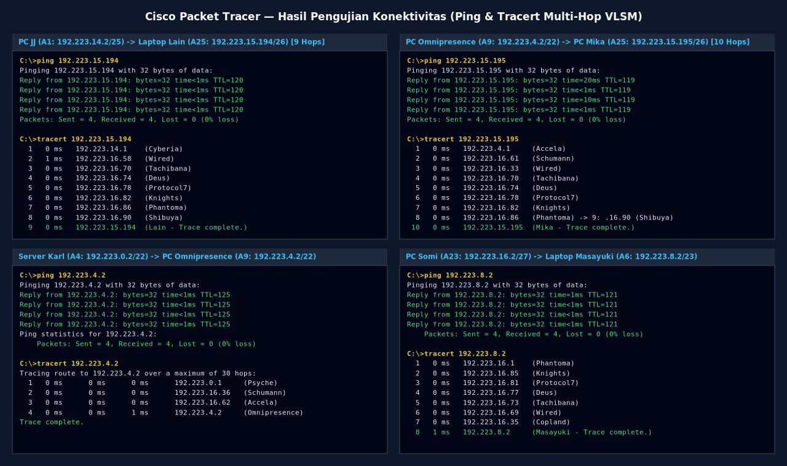

# Laporan Resmi Praktikum Komunikasi Data dan Jaringan Komputer — Modul 4 (2026)

**Topik:** Subnetting & Routing Classless (**VLSM — Variable Length Subnet Masking**) dengan **Cisco Packet Tracer**  
**Kelompok:** **K-24**  
**Institusi:** Departemen Teknologi Informasi — Institut Teknologi Sepuluh Nopember (ITS)

## Anggota Kelompok K-24

| Nama | NRP |
| :--- | :---: |
| **Wildan Alfarezy** | `5027251088` |
| **Ashkhabil Abror Budihardjo** | `5027251049` |

---

## Daftar Isi
- [Informasi Umum & Berkas Deliverables](#informasi-umum--berkas-deliverables)
- [Topologi Jaringan](#topologi-jaringan)
  - [Topologi Soal](#topologi-soal)
  - [Topologi Hasil Implementasi di Cisco Packet Tracer](#topologi-hasil-implementasi-di-cisco-packet-tracer)
- [Prefix IP](#prefix-ip)
- [Penentuan Subnet & Tabel Rute](#penentuan-subnet--tabel-rute)
- [Implementasi VLSM (Variable Length Subnet Masking)](#implementasi-vlsm-variable-length-subnet-masking)
  - [Urutan Alokasi Blok VLSM (Largest-First)](#urutan-alokasi-blok-vlsm-largest-first)
  - [VLSM IP Splitting Tree](#vlsm-ip-splitting-tree)
  - [Tabel Pembagian IP — VLSM](#tabel-pembagian-ip--vlsm)
- [Konfigurasi Perangkat (Node Configuration)](#konfigurasi-perangkat-node-configuration)
  - [Konfigurasi Interface Router (13 Router Cisco 2811)](#konfigurasi-interface-router-13-router-cisco-2811)
  - [Konfigurasi IP Client / End-Devices (25 Host)](#konfigurasi-ip-client--end-devices-25-host)
- [Konfigurasi Static Routing](#konfigurasi-static-routing)
- [Pengujian Konektivitas (Testing)](#pengujian-konektivitas-testing)

---

## Informasi Umum & Berkas Deliverables

Pada praktikum Modul 4 ini, kami mengimplementasikan teknik subnetting **VLSM (*Variable Length Subnet Masking*)** dan **Static Routing** menggunakan **Cisco Packet Tracer (CPT)** dengan rincian berkas pada repositori ini sebagai berikut:

| Berkas Deliverable | Deskripsi |
| :--- | :--- |
| [`Jarkom-Modul-4-2026-K-24.pkt`](./Jarkom-Modul-4-2026-K-24.pkt) | Berkas simulasi topologi jaringan Cisco Packet Tracer yang telah dikonfigurasi penuh (52 perangkat, 51 link, IP VLSM, dan Static Routing). |
| [`Penghitungan Subnetting Modul 4 Komdat Jarkom K-24.xlsx`](./Penghitungan%20Subnetting%20Modul%204%20Komdat%20Jarkom%20K-24.xlsx) | Berkas Spreadsheet perhitungan **Rute** dan **Pembagian IP - VLSM** sesuai template resmi praktikum. |
| [`assets/topologi_cpt.png`](./assets/topologi_cpt.png) | Tangkapan layar topologi jaringan yang telah berjalan (*up/green*) di Cisco Packet Tracer. |
| [`assets/subnet_vlsm.png`](./assets/subnet_vlsm.png) | Visualisasi pemetaan 25 subnet (`A1`–`A25`) pada topologi jaringan. |
| [`assets/rute_vlsm.png`](./assets/rute_vlsm.png) | Visualisasi Tabel Rute (`A1`–`A25`). |
| [`assets/tree_vlsm.png`](./assets/tree_vlsm.png) | Diagram Pohon Biner Pemecahan IP (*VLSM IP Splitting Binary Tree*) dari `192.223.0.0/19`. |
| [`assets/pembagian_ip_vlsm.png`](./assets/pembagian_ip_vlsm.png) | Visualisasi Tabel Pembagian IP VLSM (`Network ID`, `Netmask`, `Broadcast`, `Range IP`). |
| [`assets/testing_vlsm.png`](./assets/testing_vlsm.png) | Bukti hasil pengujian konektivitas `ping` dan `tracert` lintas cabang multi-hop. |

---

## Topologi Jaringan

Topologi terdiri atas **52 perangkat** yang terhubung melalui **51 link kabel** (*Straight-Through* dan *Copper Cross-Over*):
- **1 Cloud:** `Cloud0` (terhubung ke router pusat `Cyberia`)
- **13 Router Cisco 2811:** `Cyberia`, `Wired`, `Psyche`, `Copland`, `Schumann`, `Accela`, `Navi`, `Tachibana`, `Deus`, `Protocol7`, `Knights`, `Phantoma`, dan `Shibuya` (10 router dilengkapi modul ekspansi **`NM-2FE2W`** pada slot `1` untuk menyediakan port `FastEthernet1/0` dan `FastEthernet1/1`).
- **13 Switch (`Switch-PT`):** `Switch1` s/d `Switch13`
- **25 End-Devices (Host):**
  - **9 PC (`PC-PT`):** `JJ`, `Omnipresence`, `Reika`, `Taro`, `Yasuo`, `Ghost`, `Specter`, `Hodgeson`, `Mika`
  - **10 Laptop (`Laptop-PT`):** `MyuMyu`, `Juri`, `Masayuki`, `Denpa`, `Alice`, `Miho`, `Lilith`, `Chisa`, `Somi`, `Lain`
  - **6 Server (`Server-PT`):** `Karl`, `Lin`, `Akashic`, `Kuma`, `Collective`, `Eiri`

### Topologi Soal



### Topologi Hasil Implementasi di Cisco Packet Tracer



---

## Prefix IP

Berdasarkan pembagian kelompok praktikum, **Kelompok K-24** menggunakan prefix IP:

```
192.223.x.x
```

---

## Penentuan Subnet & Tabel Rute

Sesuai dengan ketentuan pada soal praktikum:
1. Penomoran subnet (`A1` s/d `A25`) dimulai dari jaringan di bawah `Cyberia` (`JJ, MyuMyu` sebagai `A1`), dilanjutkan ke router di bawahnya (`Wired`), kemudian menyusuri cabang kiri (`Psyche`, `Copland`, `Schumann`, `Accela`), cabang tengah (`Navi`), dan cabang kanan (`Tachibana`, `Deus`, `Protocol7`, `Knights`, `Phantoma`, `Shibuya`).
2. **Jumlah IP** setiap subnet dihitung dari **jumlah kebutuhan host ditambah jumlah interface router** yang berada pada subnet tersebut:
   $$\text{Jumlah IP} = \text{Jumlah Host} + \text{Jumlah Interface Router}$$
3. Panjang prefix **Netmask** ($/n$) dipilih sedemikian sehingga kapasitas usable host memenuhi:
   $$2^{32-n} - 2 \ge \text{Jumlah IP}$$

### Pemetaan Subnet `A1`–`A25` pada Topologi



### Tabel Rute & Kebutuhan IP



| Nama Subnet | Rute | Rincian (Host + Interface Router) | Jumlah IP | Netmask | Kapasitas Blok ($2^{32-n}$) | Usable IP ($2^{32-n}-2$) |
| :---: | :--- | :---: | :---: | :---: | :---: | :---: |
| **A1** | `Cyberia > Switch1 > JJ, MyuMyu` | $95 + 30 + 1$ | **126** | `/25` | 128 | 126 |
| **A2** | `Cyberia > Wired` | $0 + 2$ | **2** | `/30` | 4 | 2 |
| **A3** | `Wired > Switch2 > Psyche, Copland, Schumann` | $0 + 4$ | **4** | `/29` | 8 | 6 |
| **A4** | `Psyche > Switch3 > Karl, Lin` | $700 + 180 + 1$ | **881** | `/22` | 1024 | 1022 |
| **A5** | `Copland > Juri` | $31 + 1$ | **32** | `/26` | 64 | 62 |
| **A6** | `Copland > Switch4 > Masayuki` | $300 + 1$ | **301** | `/23` | 512 | 510 |
| **A7** | `Schumann > Akashic` | $3 + 1$ | **4** | `/29` | 8 | 6 |
| **A8** | `Schumann > Accela` | $0 + 2$ | **2** | `/30` | 4 | 2 |
| **A9** | `Accela > Switch5 > Omnipresence, Denpa` | $510 + 3 + 1$ | **514** | `/22` | 1024 | 1022 |
| **A10** | `Wired > Navi` | $0 + 2$ | **2** | `/30` | 4 | 2 |
| **A11** | `Navi > Switch6 > Alice, Reika` | $208 + 45 + 1$ | **254** | `/24` | 256 | 254 |
| **A12** | `Navi > Switch7 > Taro` | $57 + 1$ | **58** | `/26` | 64 | 62 |
| **A13** | `Navi > Switch8 > Yasuo, Miho, Kuma` | $120 + 18 + 4 + 1$ | **143** | `/24` | 256 | 254 |
| **A14** | `Wired > Tachibana` | $0 + 2$ | **2** | `/30` | 4 | 2 |
| **A15** | `Tachibana > Switch9 > Collective, Ghost` | $260 + 6 + 1$ | **267** | `/23` | 512 | 510 |
| **A16** | `Tachibana > Deus` | $0 + 2$ | **2** | `/30` | 4 | 2 |
| **A17** | `Deus > Switch10 > Lilith, Specter` | $77 + 21 + 1$ | **99** | `/25` | 128 | 126 |
| **A18** | `Deus > Protocol7` | $0 + 2$ | **2** | `/30` | 4 | 2 |
| **A19** | `Protocol7 > Switch11 > Chisa, Hodgeson` | $23 + 9 + 1$ | **33** | `/26` | 64 | 62 |
| **A20** | `Protocol7 > Knights` | $0 + 2$ | **2** | `/30` | 4 | 2 |
| **A21** | `Knights > Eiri` | $2 + 1$ | **3** | `/29` | 8 | 6 |
| **A22** | `Knights > Phantoma` | $0 + 2$ | **2** | `/30` | 4 | 2 |
| **A23** | `Phantoma > Switch12 > Somi` | $14 + 1$ | **15** | `/27` | 32 | 30 |
| **A24** | `Phantoma > Shibuya` | $0 + 2$ | **2** | `/30` | 4 | 2 |
| **A25** | `Shibuya > Switch13 > Lain, Mika` | $57 + 4 + 1$ | **62** | `/26` | 64 | 62 |
| **Total** | | | **2814** | **`/19`** | **4188** ($\le 8192$) | |

> **Catatan Penentuan Root Prefix `/19`:**  
> Meskipun penjumlahan mentah kebutuhan IP adalah $2814\text{ IP}$, setiap subnet pada VLSM wajib menempati blok berukuran perpangkatan dua ($2^{32-n}$). Akumulasi ukuran blok seluruh 25 subnet adalah:
> $$(2 \times 1024) + (2 \times 512) + (2 \times 256) + (2 \times 128) + (4 \times 64) + (1 \times 32) + (3 \times 8) + (9 \times 4) = 4188\text{ IP}$$
> Karena $4188 > 4096$ ($/20$), maka root binary tree VLSM yang mampu menampung seluruh 25 subnet adalah **`192.223.0.0/19`** ($2^{13} = 8192\text{ IP}$).

---

## Implementasi VLSM (Variable Length Subnet Masking)

**VLSM (*Variable Length Subnet Masking*)** adalah teknik subnetting *classless* yang membagi ruang alamat IP utama menjadi beberapa subnet dengan ukuran blok (panjang prefix netmask) yang berbeda-beda sesuai kebutuhan riil setiap segmen jaringan.

### Urutan Alokasi Blok VLSM (Largest-First)

Agar pemecahan pohon biner (*binary tree*) tidak mengalami fragmentasi internal dan menghasilkan alamat jaringan yang berurutan secara padat dari `192.223.0.0` hingga `192.223.16.91`, subnet dialokasikan mulai dari prefix dengan ukuran blok terbesar (`/22`) hingga terkecil (`/30`):

1. **Blok `/22` (1024 IP / blok — 2 Subnet):**
   - `A4` (881 IP) $\to$ `192.223.0.0/22` (`192.223.0.0` – `192.223.3.255`)
   - `A9` (514 IP) $\to$ `192.223.4.0/22` (`192.223.4.0` – `192.223.7.255`)
2. **Blok `/23` (512 IP / blok — 2 Subnet):**
   - `A6` (301 IP) $\to$ `192.223.8.0/23` (`192.223.8.0` – `192.223.9.255`)
   - `A15` (267 IP) $\to$ `192.223.10.0/23` (`192.223.10.0` – `192.223.11.255`)
3. **Blok `/24` (256 IP / blok — 2 Subnet):**
   - `A11` (254 IP) $\to$ `192.223.12.0/24` (`192.223.12.0` – `192.223.12.255`)
   - `A13` (143 IP) $\to$ `192.223.13.0/24` (`192.223.13.0` – `192.223.13.255`)
4. **Blok `/25` (128 IP / blok — 2 Subnet):**
   - `A1` (126 IP) $\to$ `192.223.14.0/25` (`192.223.14.0` – `192.223.14.127`)
   - `A17` (99 IP) $\to$ `192.223.14.128/25` (`192.223.14.128` – `192.223.14.255`)
5. **Blok `/26` (64 IP / blok — 4 Subnet):**
   - `A5` (32 IP) $\to$ `192.223.15.0/26` (`192.223.15.0` – `192.223.15.63`)
   - `A12` (58 IP) $\to$ `192.223.15.64/26` (`192.223.15.64` – `192.223.15.127`)
   - `A19` (33 IP) $\to$ `192.223.15.128/26` (`192.223.15.128` – `192.223.15.191`)
   - `A25` (62 IP) $\to$ `192.223.15.192/26` (`192.223.15.192` – `192.223.15.255`)
   *(Seluruh cabang kiri `192.223.0.0/20` habis terpakai tepat 100% tanpa sisa!)*
6. **Blok `/27` (32 IP / blok — 1 Subnet, mulai dari cabang kanan `192.223.16.0/20`):**
   - `A23` (15 IP) $\to$ `192.223.16.0/27` (`192.223.16.0` – `192.223.16.31`)
7. **Blok `/29` (8 IP / blok — 3 Subnet):**
   - `A3` (4 IP) $\to$ `192.223.16.32/29` (`192.223.16.32` – `192.223.16.39`)
   - `A7` (4 IP) $\to$ `192.223.16.40/29` (`192.223.16.40` – `192.223.16.47`)
   - `A21` (3 IP) $\to$ `192.223.16.48/29` (`192.223.16.48` – `192.223.16.55`)
8. **Blok `/30` (4 IP / blok — 9 Subnet Point-to-Point Router):**
   - `A2` (2 IP) $\to$ `192.223.16.56/30` (`192.223.16.56` – `192.223.16.59`)
   - `A8` (2 IP) $\to$ `192.223.16.60/30` (`192.223.16.60` – `192.223.16.63`)
   - `A10` (2 IP) $\to$ `192.223.16.64/30` (`192.223.16.64` – `192.223.16.67`)
   - `A14` (2 IP) $\to$ `192.223.16.68/30` (`192.223.16.68` – `192.223.16.71`)
   - `A16` (2 IP) $\to$ `192.223.16.72/30` (`192.223.16.72` – `192.223.16.75`)
   - `A18` (2 IP) $\to$ `192.223.16.76/30` (`192.223.16.76` – `192.223.16.79`)
   - `A20` (2 IP) $\to$ `192.223.16.80/30` (`192.223.16.80` – `192.223.16.83`)
   - `A22` (2 IP) $\to$ `192.223.16.84/30` (`192.223.16.84` – `192.223.16.87`)
   - `A24` (2 IP) $\to$ `192.223.16.88/30` (`192.223.16.88` – `192.223.16.91`)

---

### VLSM IP Splitting Tree

Berikut adalah diagram pohon biner (*Binary Splitting Tree*) pemecahan blok IP `192.223.0.0/19` menjadi 25 subnet (`A1`–`A25`):

```mermaid
flowchart TD
    R["192.223.0.0/19 (8192 IP)"] --> L20_0["192.223.0.0/20 (4096 IP)"]
    R --> L20_16["192.223.16.0/20 (4096 IP)"]

    %% Left /20 (0.0 - 15.255)
    L20_0 --> L21_0["192.223.0.0/21"]
    L20_0 --> L21_8["192.223.8.0/21"]

    L21_0 --> A4["A4: 192.223.0.0/22 (881 IP)"]
    L21_0 --> A9["A9: 192.223.4.0/22 (514 IP)"]

    L21_8 --> L22_8["192.223.8.0/22"]
    L21_8 --> L22_12["192.223.12.0/22"]

    L22_8 --> A6["A6: 192.223.8.0/23 (301 IP)"]
    L22_8 --> A15["A15: 192.223.10.0/23 (267 IP)"]

    L22_12 --> L23_12["192.223.12.0/23"]
    L22_12 --> L23_14["192.223.14.0/23"]

    L23_12 --> A11["A11: 192.223.12.0/24 (254 IP)"]
    L23_12 --> A13["A13: 192.223.13.0/24 (143 IP)"]

    L23_14 --> L24_14["192.223.14.0/24"]
    L23_14 --> L24_15["192.223.15.0/24"]

    L24_14 --> A1["A1: 192.223.14.0/25 (126 IP)"]
    L24_14 --> A17["A17: 192.223.14.128/25 (99 IP)"]

    L24_15 --> L25_15_0["192.223.15.0/25"]
    L24_15 --> L25_15_128["192.223.15.128/25"]

    L25_15_0 --> A5["A5: 192.223.15.0/26 (32 IP)"]
    L25_15_0 --> A12["A12: 192.223.15.64/26 (58 IP)"]

    L25_15_128 --> A19["A19: 192.223.15.128/26 (33 IP)"]
    L25_15_128 --> A25["A25: 192.223.15.192/26 (62 IP)"]

    %% Right /20 (16.0 - 31.255)
    L20_16 --> L21_16["192.223.16.0/21"]
    L21_16 --> L22_16["192.223.16.0/22"]
    L22_16 --> L23_16["192.223.16.0/23"]
    L23_16 --> L24_16["192.223.16.0/24"]
    L24_16 --> L25_16["192.223.16.0/25"]

    L25_16 --> L26_16_0["192.223.16.0/26"]
    L25_16 --> L26_16_64["192.223.16.64/26"]

    L26_16_0 --> A23["A23: 192.223.16.0/27 (15 IP)"]
    L26_16_0 --> L27_16_32["192.223.16.32/27"]

    L27_16_32 --> L28_16_32["192.223.16.32/28"]
    L27_16_32 --> L28_16_48["192.223.16.48/28"]

    L28_16_32 --> A3["A3: 192.223.16.32/29 (4 IP)"]
    L28_16_32 --> A7["A7: 192.223.16.40/29 (4 IP)"]

    L28_16_48 --> A21["A21: 192.223.16.48/29 (3 IP)"]
    L28_16_48 --> L29_16_56["192.223.16.56/29"]

    L29_16_56 --> A2["A2: 192.223.16.56/30 (2 IP)"]
    L29_16_56 --> A8["A8: 192.223.16.60/30 (2 IP)"]

    L26_16_64 --> L27_16_64["192.223.16.64/27"]
    L27_16_64 --> L28_16_64["192.223.16.64/28"]
    L27_16_64 --> L28_16_80["192.223.16.80/28"]

    L28_16_64 --> L29_16_64["192.223.16.64/29"]
    L28_16_64 --> L29_16_72["192.223.16.72/29"]

    L29_16_64 --> A10["A10: 192.223.16.64/30 (2 IP)"]
    L29_16_64 --> A14["A14: 192.223.16.68/30 (2 IP)"]

    L29_16_72 --> A16["A16: 192.223.16.72/30 (2 IP)"]
    L29_16_72 --> A18["A18: 192.223.16.76/30 (2 IP)"]

    L28_16_80 --> L29_16_80["192.223.16.80/29"]
    L28_16_80 --> L29_16_88["192.223.16.88/29"]

    L29_16_80 --> A20["A20: 192.223.16.80/30 (2 IP)"]
    L29_16_80 --> A22["A22: 192.223.16.84/30 (2 IP)"]

    L29_16_88 --> A24["A24: 192.223.16.88/30 (2 IP)"]
```



<details>
<summary><b>Klik untuk melihat Diagram Mermaid Interaktif VLSM Binary Tree</b></summary>



</details>

---

### Tabel Pembagian IP — VLSM

Berikut adalah tabel lengkap pembagian alamat IP VLSM untuk seluruh 25 subnet (`A1`–`A25`):



| Subnet | Network ID | Netmask | Broadcast | Range IP |
| :---: | :---: | :---: | :---: | :---: |
| **A1** | `192.223.14.0` | `255.255.255.128` | `192.223.14.127` | `192.223.14.1 - 192.223.14.126` |
| **A2** | `192.223.16.56` | `255.255.255.252` | `192.223.16.59` | `192.223.16.57 - 192.223.16.58` |
| **A3** | `192.223.16.32` | `255.255.255.248` | `192.223.16.39` | `192.223.16.33 - 192.223.16.38` |
| **A4** | `192.223.0.0` | `255.255.252.0` | `192.223.3.255` | `192.223.0.1 - 192.223.3.254` |
| **A5** | `192.223.15.0` | `255.255.255.192` | `192.223.15.63` | `192.223.15.1 - 192.223.15.62` |
| **A6** | `192.223.8.0` | `255.255.254.0` | `192.223.9.255` | `192.223.8.1 - 192.223.9.254` |
| **A7** | `192.223.16.40` | `255.255.255.248` | `192.223.16.47` | `192.223.16.41 - 192.223.16.46` |
| **A8** | `192.223.16.60` | `255.255.255.252` | `192.223.16.63` | `192.223.16.61 - 192.223.16.62` |
| **A9** | `192.223.4.0` | `255.255.252.0` | `192.223.7.255` | `192.223.4.1 - 192.223.7.254` |
| **A10** | `192.223.16.64` | `255.255.255.252` | `192.223.16.67` | `192.223.16.65 - 192.223.16.66` |
| **A11** | `192.223.12.0` | `255.255.255.0` | `192.223.12.255` | `192.223.12.1 - 192.223.12.254` |
| **A12** | `192.223.15.64` | `255.255.255.192` | `192.223.15.127` | `192.223.15.65 - 192.223.15.126` |
| **A13** | `192.223.13.0` | `255.255.255.0` | `192.223.13.255` | `192.223.13.1 - 192.223.13.254` |
| **A14** | `192.223.16.68` | `255.255.255.252` | `192.223.16.71` | `192.223.16.69 - 192.223.16.70` |
| **A15** | `192.223.10.0` | `255.255.254.0` | `192.223.11.255` | `192.223.10.1 - 192.223.11.254` |
| **A16** | `192.223.16.72` | `255.255.255.252` | `192.223.16.75` | `192.223.16.73 - 192.223.16.74` |
| **A17** | `192.223.14.128` | `255.255.255.128` | `192.223.14.255` | `192.223.14.129 - 192.223.14.254` |
| **A18** | `192.223.16.76` | `255.255.255.252` | `192.223.16.79` | `192.223.16.77 - 192.223.16.78` |
| **A19** | `192.223.15.128` | `255.255.255.192` | `192.223.15.191` | `192.223.15.129 - 192.223.15.190` |
| **A20** | `192.223.16.80` | `255.255.255.252` | `192.223.16.83` | `192.223.16.81 - 192.223.16.82` |
| **A21** | `192.223.16.48` | `255.255.255.248` | `192.223.16.55` | `192.223.16.49 - 192.223.16.54` |
| **A22** | `192.223.16.84` | `255.255.255.252` | `192.223.16.87` | `192.223.16.85 - 192.223.16.86` |
| **A23** | `192.223.16.0` | `255.255.255.224` | `192.223.16.31` | `192.223.16.1 - 192.223.16.30` |
| **A24** | `192.223.16.88` | `255.255.255.252` | `192.223.16.91` | `192.223.16.89 - 192.223.16.90` |
| **A25** | `192.223.15.192` | `255.255.255.192` | `192.223.15.255` | `192.223.15.193 - 192.223.15.254` |

---

## Konfigurasi Perangkat (Node Configuration)

### Konfigurasi Interface Router (13 Router Cisco 2811)

Sepuluh router yang memiliki lebih dari 2 koneksi Ethernet (`Cyberia`, `Wired`, `Copland`, `Schumann`, `Navi`, `Tachibana`, `Deus`, `Protocol7`, `Knights`, `Phantoma`) dipasangi modul **`NM-2FE2W`** pada slot `1` sehingga memiliki port `FastEthernet0/0`, `FastEthernet0/1`, `FastEthernet1/0`, dan `FastEthernet1/1`.

| Nama Router | Interface | Subnet | IP Address | Netmask | Terhubung Ke |
| :--- | :--- | :---: | :--- | :--- | :--- |
| **Cyberia** | `FastEthernet1/0` | - | *(Uplink Cloud)* | - | `Cloud0 (Ethernet6)` |
| | `FastEthernet0/0` | `A1` | `192.223.14.1` | `255.255.255.128` | `Switch1` (`JJ`, `MyuMyu`) |
| | `FastEthernet0/1` | `A2` | `192.223.16.57` | `255.255.255.252` | `Wired (FastEthernet0/0)` |
| **Wired** | `FastEthernet0/0` | `A2` | `192.223.16.58` | `255.255.255.252` | `Cyberia (FastEthernet0/1)` |
| | `FastEthernet0/1` | `A3` | `192.223.16.33` | `255.255.255.248` | `Switch2` (`Psyche`, `Copland`, `Schumann`) |
| | `FastEthernet1/0` | `A10` | `192.223.16.65` | `255.255.255.252` | `Navi (FastEthernet0/0)` |
| | `FastEthernet1/1` | `A14` | `192.223.16.69` | `255.255.255.252` | `Tachibana (FastEthernet0/0)` |
| **Psyche** | `FastEthernet0/0` | `A3` | `192.223.16.34` | `255.255.255.248` | `Switch2` |
| | `FastEthernet0/1` | `A4` | `192.223.0.1` | `255.255.252.0` | `Switch3` (`Karl`, `Lin`) |
| **Copland** | `FastEthernet0/0` | `A3` | `192.223.16.35` | `255.255.255.248` | `Switch2` |
| | `FastEthernet0/1` | `A5` | `192.223.15.1` | `255.255.255.192` | `Juri` *(Direct Cross-Over)* |
| | `FastEthernet1/0` | `A6` | `192.223.8.1` | `255.255.254.0` | `Switch4` (`Masayuki`) |
| **Schumann** | `FastEthernet0/0` | `A3` | `192.223.16.36` | `255.255.255.248` | `Switch2` |
| | `FastEthernet0/1` | `A7` | `192.223.16.41` | `255.255.255.248` | `Akashic` *(Direct Cross-Over)* |
| | `FastEthernet1/0` | `A8` | `192.223.16.61` | `255.255.255.252` | `Accela (FastEthernet0/0)` |
| **Accela** | `FastEthernet0/0` | `A8` | `192.223.16.62` | `255.255.255.252` | `Schumann (FastEthernet1/0)` |
| | `FastEthernet0/1` | `A9` | `192.223.4.1` | `255.255.252.0` | `Switch5` (`Omnipresence`, `Denpa`) |
| **Navi** | `FastEthernet0/0` | `A10` | `192.223.16.66` | `255.255.255.252` | `Wired (FastEthernet1/0)` |
| | `FastEthernet0/1` | `A11` | `192.223.12.1` | `255.255.255.0` | `Switch6` (`Alice`, `Reika`) |
| | `FastEthernet1/0` | `A12` | `192.223.15.65` | `255.255.255.192` | `Switch7` (`Taro`) |
| | `FastEthernet1/1` | `A13` | `192.223.13.1` | `255.255.255.0` | `Switch8` (`Yasuo`, `Miho`, `Kuma`) |
| **Tachibana** | `FastEthernet0/0` | `A14` | `192.223.16.70` | `255.255.255.252` | `Wired (FastEthernet1/1)` |
| | `FastEthernet0/1` | `A15` | `192.223.10.1` | `255.255.254.0` | `Switch9` (`Collective`, `Ghost`) |
| | `FastEthernet1/0` | `A16` | `192.223.16.73` | `255.255.255.252` | `Deus (FastEthernet0/0)` |
| **Deus** | `FastEthernet0/0` | `A16` | `192.223.16.74` | `255.255.255.252` | `Tachibana (FastEthernet1/0)` |
| | `FastEthernet0/1` | `A17` | `192.223.14.129` | `255.255.255.128` | `Switch10` (`Lilith`, `Specter`) |
| | `FastEthernet1/0` | `A18` | `192.223.16.77` | `255.255.255.252` | `Protocol7 (FastEthernet0/0)` |
| **Protocol7** | `FastEthernet0/0` | `A18` | `192.223.16.78` | `255.255.255.252` | `Deus (FastEthernet1/0)` |
| | `FastEthernet0/1` | `A19` | `192.223.15.129` | `255.255.255.192` | `Switch11` (`Chisa`, `Hodgeson`) |
| | `FastEthernet1/0` | `A20` | `192.223.16.81` | `255.255.255.252` | `Knights (FastEthernet0/0)` |
| **Knights** | `FastEthernet0/0` | `A20` | `192.223.16.82` | `255.255.255.252` | `Protocol7 (FastEthernet1/0)` |
| | `FastEthernet0/1` | `A21` | `192.223.16.49` | `255.255.255.248` | `Eiri` *(Direct Cross-Over)* |
| | `FastEthernet1/0` | `A22` | `192.223.16.85` | `255.255.255.252` | `Phantoma (FastEthernet0/0)` |
| **Phantoma** | `FastEthernet0/0` | `A22` | `192.223.16.86` | `255.255.255.252` | `Knights (FastEthernet1/0)` |
| | `FastEthernet0/1` | `A23` | `192.223.16.1` | `255.255.255.224` | `Switch12` (`Somi`) |
| | `FastEthernet1/0` | `A24` | `192.223.16.89` | `255.255.255.252` | `Shibuya (FastEthernet0/0)` |
| **Shibuya** | `FastEthernet0/0` | `A24` | `192.223.16.90` | `255.255.255.252` | `Phantoma (FastEthernet1/0)` |
| | `FastEthernet0/1` | `A25` | `192.223.15.193` | `255.255.255.192` | `Switch13` (`Lain`, `Mika`) |

<details>
<summary><b>Klik untuk melihat Perintah CLI Konfigurasi Interface Seluruh 13 Router</b></summary>

```ios
! === 1. Cyberia ===
enable
configure terminal
hostname Cyberia
interface FastEthernet1/0
 no shutdown
 exit
interface FastEthernet0/0
 ip address 192.223.14.1 255.255.255.128
 no shutdown
 exit
interface FastEthernet0/1
 ip address 192.223.16.57 255.255.255.252
 no shutdown
 exit

! === 2. Wired ===
enable
configure terminal
hostname Wired
interface FastEthernet0/0
 ip address 192.223.16.58 255.255.255.252
 no shutdown
 exit
interface FastEthernet0/1
 ip address 192.223.16.33 255.255.255.248
 no shutdown
 exit
interface FastEthernet1/0
 ip address 192.223.16.65 255.255.255.252
 no shutdown
 exit
interface FastEthernet1/1
 ip address 192.223.16.69 255.255.255.252
 no shutdown
 exit

! === 3. Psyche ===
enable
configure terminal
hostname Psyche
interface FastEthernet0/0
 ip address 192.223.16.34 255.255.255.248
 no shutdown
 exit
interface FastEthernet0/1
 ip address 192.223.0.1 255.255.252.0
 no shutdown
 exit

! === 4. Copland ===
enable
configure terminal
hostname Copland
interface FastEthernet0/0
 ip address 192.223.16.35 255.255.255.248
 no shutdown
 exit
interface FastEthernet0/1
 ip address 192.223.15.1 255.255.255.192
 no shutdown
 exit
interface FastEthernet1/0
 ip address 192.223.8.1 255.255.254.0
 no shutdown
 exit

! === 5. Schumann ===
enable
configure terminal
hostname Schumann
interface FastEthernet0/0
 ip address 192.223.16.36 255.255.255.248
 no shutdown
 exit
interface FastEthernet0/1
 ip address 192.223.16.41 255.255.255.248
 no shutdown
 exit
interface FastEthernet1/0
 ip address 192.223.16.61 255.255.255.252
 no shutdown
 exit

! === 6. Accela ===
enable
configure terminal
hostname Accela
interface FastEthernet0/0
 ip address 192.223.16.62 255.255.255.252
 no shutdown
 exit
interface FastEthernet0/1
 ip address 192.223.4.1 255.255.252.0
 no shutdown
 exit

! === 7. Navi ===
enable
configure terminal
hostname Navi
interface FastEthernet0/0
 ip address 192.223.16.66 255.255.255.252
 no shutdown
 exit
interface FastEthernet0/1
 ip address 192.223.12.1 255.255.255.0
 no shutdown
 exit
interface FastEthernet1/0
 ip address 192.223.15.65 255.255.255.192
 no shutdown
 exit
interface FastEthernet1/1
 ip address 192.223.13.1 255.255.255.0
 no shutdown
 exit

! === 8. Tachibana ===
enable
configure terminal
hostname Tachibana
interface FastEthernet0/0
 ip address 192.223.16.70 255.255.255.252
 no shutdown
 exit
interface FastEthernet0/1
 ip address 192.223.10.1 255.255.254.0
 no shutdown
 exit
interface FastEthernet1/0
 ip address 192.223.16.73 255.255.255.252
 no shutdown
 exit

! === 9. Deus ===
enable
configure terminal
hostname Deus
interface FastEthernet0/0
 ip address 192.223.16.74 255.255.255.252
 no shutdown
 exit
interface FastEthernet0/1
 ip address 192.223.14.129 255.255.255.128
 no shutdown
 exit
interface FastEthernet1/0
 ip address 192.223.16.77 255.255.255.252
 no shutdown
 exit

! === 10. Protocol7 ===
enable
configure terminal
hostname Protocol7
interface FastEthernet0/0
 ip address 192.223.16.78 255.255.255.252
 no shutdown
 exit
interface FastEthernet0/1
 ip address 192.223.15.129 255.255.255.192
 no shutdown
 exit
interface FastEthernet1/0
 ip address 192.223.16.81 255.255.255.252
 no shutdown
 exit

! === 11. Knights ===
enable
configure terminal
hostname Knights
interface FastEthernet0/0
 ip address 192.223.16.82 255.255.255.252
 no shutdown
 exit
interface FastEthernet0/1
 ip address 192.223.16.49 255.255.255.248
 no shutdown
 exit
interface FastEthernet1/0
 ip address 192.223.16.85 255.255.255.252
 no shutdown
 exit

! === 12. Phantoma ===
enable
configure terminal
hostname Phantoma
interface FastEthernet0/0
 ip address 192.223.16.86 255.255.255.252
 no shutdown
 exit
interface FastEthernet0/1
 ip address 192.223.16.1 255.255.255.224
 no shutdown
 exit
interface FastEthernet1/0
 ip address 192.223.16.89 255.255.255.252
 no shutdown
 exit

! === 13. Shibuya ===
enable
configure terminal
hostname Shibuya
interface FastEthernet0/0
 ip address 192.223.16.90 255.255.255.252
 no shutdown
 exit
interface FastEthernet0/1
 ip address 192.223.15.193 255.255.255.192
 no shutdown
 exit
```

</details>

---

### Konfigurasi IP Client / End-Devices (25 Host)

Seluruh 25 perangkat akhir (`PC-PT`, `Laptop-PT`, `Server-PT`) dikonfigurasi secara **Static** melalui menu *Desktop > IP Configuration* dengan rincian berikut:

| No | Nama Host | Tipe Perangkat | Kebutuhan Host | Subnet | IP Address | Subnet Mask | Default Gateway |
| :---: | :--- | :---: | :---: | :---: | :---: | :---: | :---: |
| 1 | **JJ** | `PC-PT` | 95 Host | `A1` (`/25`) | `192.223.14.2` | `255.255.255.128` | `192.223.14.1` |
| 2 | **MyuMyu** | `Laptop-PT` | 30 Host | `A1` (`/25`) | `192.223.14.3` | `255.255.255.128` | `192.223.14.1` |
| 3 | **Karl** | `Server-PT` | 700 Host | `A4` (`/22`) | `192.223.0.2` | `255.255.252.0` | `192.223.0.1` |
| 4 | **Lin** | `Server-PT` | 180 Host | `A4` (`/22`) | `192.223.0.3` | `255.255.252.0` | `192.223.0.1` |
| 5 | **Juri** | `Laptop-PT` | 31 Host | `A5` (`/26`) | `192.223.15.2` | `255.255.255.192` | `192.223.15.1` |
| 6 | **Masayuki** | `Laptop-PT` | 300 Host | `A6` (`/23`) | `192.223.8.2` | `255.255.254.0` | `192.223.8.1` |
| 7 | **Akashic** | `Server-PT` | 3 Host | `A7` (`/29`) | `192.223.16.42` | `255.255.255.248` | `192.223.16.41` |
| 8 | **Omnipresence** | `PC-PT` | 510 Host | `A9` (`/22`) | `192.223.4.2` | `255.255.252.0` | `192.223.4.1` |
| 9 | **Denpa** | `Laptop-PT` | 3 Host | `A9` (`/22`) | `192.223.4.3` | `255.255.252.0` | `192.223.4.1` |
| 10 | **Alice** | `Laptop-PT` | 208 Host | `A11` (`/24`) | `192.223.12.2` | `255.255.255.0` | `192.223.12.1` |
| 11 | **Reika** | `PC-PT` | 45 Host | `A11` (`/24`) | `192.223.12.3` | `255.255.255.0` | `192.223.12.1` |
| 12 | **Taro** | `PC-PT` | 57 Host | `A12` (`/26`) | `192.223.15.66` | `255.255.255.192` | `192.223.15.65` |
| 13 | **Yasuo** | `PC-PT` | 120 Host | `A13` (`/24`) | `192.223.13.2` | `255.255.255.0` | `192.223.13.1` |
| 14 | **Miho** | `Laptop-PT` | 18 Host | `A13` (`/24`) | `192.223.13.3` | `255.255.255.0` | `192.223.13.1` |
| 15 | **Kuma** | `Server-PT` | 4 Host | `A13` (`/24`) | `192.223.13.4` | `255.255.255.0` | `192.223.13.1` |
| 16 | **Collective** | `Server-PT` | 260 Host | `A15` (`/23`) | `192.223.10.2` | `255.255.254.0` | `192.223.10.1` |
| 17 | **Ghost** | `PC-PT` | 6 Host | `A15` (`/23`) | `192.223.10.3` | `255.255.254.0` | `192.223.10.1` |
| 18 | **Lilith** | `Laptop-PT` | 77 Host | `A17` (`/25`) | `192.223.14.130` | `255.255.255.128` | `192.223.14.129` |
| 19 | **Specter** | `PC-PT` | 21 Host | `A17` (`/25`) | `192.223.14.131` | `255.255.255.128` | `192.223.14.129` |
| 20 | **Chisa** | `Laptop-PT` | 23 Host | `A19` (`/26`) | `192.223.15.130` | `255.255.255.192` | `192.223.15.129` |
| 21 | **Hodgeson** | `PC-PT` | 9 Host | `A19` (`/26`) | `192.223.15.131` | `255.255.255.192` | `192.223.15.129` |
| 22 | **Eiri** | `Server-PT` | 2 Host | `A21` (`/29`) | `192.223.16.50` | `255.255.255.248` | `192.223.16.49` |
| 23 | **Somi** | `PC-PT` | 14 Host | `A23` (`/27`) | `192.223.16.2` | `255.255.255.224` | `192.223.16.1` |
| 24 | **Lain** | `Laptop-PT` | 57 Host | `A25` (`/26`) | `192.223.15.194` | `255.255.255.192` | `192.223.15.193` |
| 25 | **Mika** | `PC-PT` | 4 Host | `A25` (`/26`) | `192.223.15.195` | `255.255.255.192` | `192.223.15.193` |

---

## Konfigurasi Static Routing

Pada metode **VLSM** (tanpa agregasi supernet CIDR), setiap router meneruskan paket menuju jaringan *downstream* menggunakan entri rute statis per-subnet (`ip route <Network_ID> <Netmask> <Next_Hop_IP>`), serta meneruskan paket menuju jaringan *upstream* ke arah router pusat (`Cyberia`) melalui gateway *upstream*-nya:

- **1. Router `Cyberia` (Router Pusat di bawah `Cloud0`):**
  Mengarahkan seluruh 23 subnet di bawahnya (`A3` s/d `A25`) melalui `Wired` (`192.223.16.58`):
  ```ios
  ip route 192.223.16.32 255.255.255.248 192.223.16.58
  ip route 192.223.0.0 255.255.252.0 192.223.16.58
  ip route 192.223.15.0 255.255.255.192 192.223.16.58
  ip route 192.223.8.0 255.255.254.0 192.223.16.58
  ip route 192.223.16.40 255.255.255.248 192.223.16.58
  ip route 192.223.16.60 255.255.255.252 192.223.16.58
  ip route 192.223.4.0 255.255.252.0 192.223.16.58
  ip route 192.223.16.64 255.255.255.252 192.223.16.58
  ip route 192.223.12.0 255.255.255.0 192.223.16.58
  ip route 192.223.15.64 255.255.255.192 192.223.16.58
  ip route 192.223.13.0 255.255.255.0 192.223.16.58
  ip route 192.223.16.68 255.255.255.252 192.223.16.58
  ip route 192.223.10.0 255.255.254.0 192.223.16.58
  ip route 192.223.16.72 255.255.255.252 192.223.16.58
  ip route 192.223.14.128 255.255.255.128 192.223.16.58
  ip route 192.223.16.76 255.255.255.252 192.223.16.58
  ip route 192.223.15.128 255.255.255.192 192.223.16.58
  ip route 192.223.16.80 255.255.255.252 192.223.16.58
  ip route 192.223.16.48 255.255.255.248 192.223.16.58
  ip route 192.223.16.84 255.255.255.252 192.223.16.58
  ip route 192.223.16.0 255.255.255.224 192.223.16.58
  ip route 192.223.16.88 255.255.255.252 192.223.16.58
  ip route 192.223.15.192 255.255.255.192 192.223.16.58
  ```

- **2. Router `Wired` (Router Distribusi Utama):**
  ```ios
  ! Menuju Cyberia (A1 & Default Upstream)
  ip route 192.223.14.0 255.255.255.128 192.223.16.57
  ip route 0.0.0.0 0.0.0.0 192.223.16.57

  ! Menuju Cabang Kiri via Switch2 (Psyche, Copland, Schumann)
  ip route 192.223.0.0 255.255.252.0 192.223.16.34
  ip route 192.223.15.0 255.255.255.192 192.223.16.35
  ip route 192.223.8.0 255.255.254.0 192.223.16.35
  ip route 192.223.16.40 255.255.255.248 192.223.16.36
  ip route 192.223.16.60 255.255.255.252 192.223.16.36
  ip route 192.223.4.0 255.255.252.0 192.223.16.36

  ! Menuju Cabang Tengah via Navi
  ip route 192.223.12.0 255.255.255.0 192.223.16.66
  ip route 192.223.15.64 255.255.255.192 192.223.16.66
  ip route 192.223.13.0 255.255.255.0 192.223.16.66

  ! Menuju Cabang Kanan via Tachibana
  ip route 192.223.10.0 255.255.254.0 192.223.16.70
  ip route 192.223.16.72 255.255.255.252 192.223.16.70
  ip route 192.223.14.128 255.255.255.128 192.223.16.70
  ip route 192.223.16.76 255.255.255.252 192.223.16.70
  ip route 192.223.15.128 255.255.255.192 192.223.16.70
  ip route 192.223.16.80 255.255.255.252 192.223.16.70
  ip route 192.223.16.48 255.255.255.248 192.223.16.70
  ip route 192.223.16.84 255.255.255.252 192.223.16.70
  ip route 192.223.16.0 255.255.255.224 192.223.16.70
  ip route 192.223.16.88 255.255.255.252 192.223.16.70
  ip route 192.223.15.192 255.255.255.192 192.223.16.70
  ```

- **3. Router `Psyche`:**
  ```ios
  ip route 192.223.15.0 255.255.255.192 192.223.16.35
  ip route 192.223.8.0 255.255.254.0 192.223.16.35
  ip route 192.223.16.40 255.255.255.248 192.223.16.36
  ip route 192.223.16.60 255.255.255.252 192.223.16.36
  ip route 192.223.4.0 255.255.252.0 192.223.16.36
  ip route 0.0.0.0 0.0.0.0 192.223.16.33
  ```

- **4. Router `Copland`:**
  ```ios
  ip route 192.223.0.0 255.255.252.0 192.223.16.34
  ip route 192.223.16.40 255.255.255.248 192.223.16.36
  ip route 192.223.16.60 255.255.255.252 192.223.16.36
  ip route 192.223.4.0 255.255.252.0 192.223.16.36
  ip route 0.0.0.0 0.0.0.0 192.223.16.33
  ```

- **5. Router `Schumann`:**
  ```ios
  ip route 192.223.0.0 255.255.252.0 192.223.16.34
  ip route 192.223.15.0 255.255.255.192 192.223.16.35
  ip route 192.223.8.0 255.255.254.0 192.223.16.35
  ip route 192.223.4.0 255.255.252.0 192.223.16.62
  ip route 0.0.0.0 0.0.0.0 192.223.16.33
  ```

- **6. Router `Accela`:**
  ```ios
  ip route 0.0.0.0 0.0.0.0 192.223.16.61
  ```

- **7. Router `Navi`:**
  ```ios
  ip route 0.0.0.0 0.0.0.0 192.223.16.65
  ```

- **8. Router `Tachibana`:**
  ```ios
  ip route 192.223.14.128 255.255.255.128 192.223.16.74
  ip route 192.223.16.76 255.255.255.252 192.223.16.74
  ip route 192.223.15.128 255.255.255.192 192.223.16.74
  ip route 192.223.16.80 255.255.255.252 192.223.16.74
  ip route 192.223.16.48 255.255.255.248 192.223.16.74
  ip route 192.223.16.84 255.255.255.252 192.223.16.74
  ip route 192.223.16.0 255.255.255.224 192.223.16.74
  ip route 192.223.16.88 255.255.255.252 192.223.16.74
  ip route 192.223.15.192 255.255.255.192 192.223.16.74
  ip route 0.0.0.0 0.0.0.0 192.223.16.69
  ```

- **9. Router `Deus`:**
  ```ios
  ip route 192.223.15.128 255.255.255.192 192.223.16.78
  ip route 192.223.16.80 255.255.255.252 192.223.16.78
  ip route 192.223.16.48 255.255.255.248 192.223.16.78
  ip route 192.223.16.84 255.255.255.252 192.223.16.78
  ip route 192.223.16.0 255.255.255.224 192.223.16.78
  ip route 192.223.16.88 255.255.255.252 192.223.16.78
  ip route 192.223.15.192 255.255.255.192 192.223.16.78
  ip route 0.0.0.0 0.0.0.0 192.223.16.73
  ```

- **10. Router `Protocol7`:**
  ```ios
  ip route 192.223.16.48 255.255.255.248 192.223.16.82
  ip route 192.223.16.84 255.255.255.252 192.223.16.82
  ip route 192.223.16.0 255.255.255.224 192.223.16.82
  ip route 192.223.16.88 255.255.255.252 192.223.16.82
  ip route 192.223.15.192 255.255.255.192 192.223.16.82
  ip route 0.0.0.0 0.0.0.0 192.223.16.77
  ```

- **11. Router `Knights`:**
  ```ios
  ip route 192.223.16.0 255.255.255.224 192.223.16.86
  ip route 192.223.16.88 255.255.255.252 192.223.16.86
  ip route 192.223.15.192 255.255.255.192 192.223.16.86
  ip route 0.0.0.0 0.0.0.0 192.223.16.81
  ```

- **12. Router `Phantoma`:**
  ```ios
  ip route 192.223.15.192 255.255.255.192 192.223.16.90
  ip route 0.0.0.0 0.0.0.0 192.223.16.85
  ```

- **13. Router `Shibuya`:**
  ```ios
  ip route 0.0.0.0 0.0.0.0 192.223.16.89
  ```

---

## Pengujian Konektivitas (Testing)

Untuk membuktikan bahwa pembagian subnet VLSM dan *Static Routing* telah berjalan dengan benar di seluruh cabang jaringan (bukan hanya antar 1–2 router yang bersebelahan), kami melakukan pengujian **`ping`** dan **`tracert`** antar ujung topologi terjauh (hingga **9–10 hop router**):



### 1. Pengujian Ujung Atas (`JJ` pada `A1`) $\to$ Ujung Kanan Bawah (`Lain` pada `A25`) — 9 Hops
Melintasi 8 router: `Cyberia` $\to$ `Wired` $\to$ `Tachibana` $\to$ `Deus` $\to$ `Protocol7` $\to$ `Knights` $\to$ `Phantoma` $\to$ `Shibuya`:
```text
C:\>tracert 192.223.15.194
Tracing route to 192.223.15.194 over a maximum of 30 hops: 

  1   0 ms      0 ms      0 ms      192.223.14.1
  2   1 ms      1 ms      0 ms      192.223.16.58
  3   0 ms      0 ms      0 ms      192.223.16.70
  4   0 ms      0 ms      0 ms      192.223.16.74
  5   0 ms      0 ms      0 ms      192.223.16.78
  6   0 ms      0 ms      0 ms      192.223.16.82
  7   0 ms      0 ms      1 ms      192.223.16.86
  8   0 ms      0 ms      0 ms      192.223.16.90
  9   0 ms      0 ms      0 ms      192.223.15.194

Trace complete.

C:\>ping 192.223.15.194
Pinging 192.223.15.194 with 32 bytes of data:

Reply from 192.223.15.194: bytes=32 time<1ms TTL=120
Reply from 192.223.15.194: bytes=32 time<1ms TTL=120
Reply from 192.223.15.194: bytes=32 time<1ms TTL=120
Reply from 192.223.15.194: bytes=32 time<1ms TTL=120

Ping statistics for 192.223.15.194:
    Packets: Sent = 4, Received = 4, Lost = 0 (0% loss),
```

### 2. Pengujian Cabang Kiri Bawah (`Omnipresence` pada `A9`) $\to$ Cabang Kanan Bawah (`Mika` pada `A25`) — 10 Hops
Melintasi 9 router: `Accela` $\to$ `Schumann` $\to$ `Wired` $\to$ `Tachibana` $\to$ `Deus` $\to$ `Protocol7` $\to$ `Knights` $\to$ `Phantoma` $\to$ `Shibuya`:
```text
C:\>tracert 192.223.15.195
Tracing route to 192.223.15.195 over a maximum of 30 hops: 

  1   0 ms      0 ms      0 ms      192.223.4.1
  2   0 ms      0 ms      0 ms      192.223.16.61
  3   *         0 ms      0 ms      192.223.16.33
  4   0 ms      0 ms      0 ms      192.223.16.70
  5   0 ms      0 ms      0 ms      192.223.16.74
  6   0 ms      0 ms      0 ms      192.223.16.78
  7   0 ms      0 ms      0 ms      192.223.16.82
  8   0 ms      0 ms      0 ms      192.223.16.86
  9   0 ms      0 ms      0 ms      192.223.16.90
  10  *         1 ms      0 ms      192.223.15.195

Trace complete.

C:\>ping 192.223.15.195
Pinging 192.223.15.195 with 32 bytes of data:

Reply from 192.223.15.195: bytes=32 time=20ms TTL=119
Reply from 192.223.15.195: bytes=32 time<1ms TTL=119
Reply from 192.223.15.195: bytes=32 time=10ms TTL=119
Reply from 192.223.15.195: bytes=32 time<1ms TTL=119

Ping statistics for 192.223.15.195:
    Packets: Sent = 4, Received = 4, Lost = 0 (0% loss),
```

### 3. Pengujian Antar-Cabang Kiri (`Karl` pada `A4`) $\to$ (`Omnipresence` pada `A9`) & Cabang Kanan (`Somi` pada `A23`) $\to$ (`Masayuki` pada `A6`)
```text
C:\>ping 192.223.4.2
Reply from 192.223.4.2: bytes=32 time<1ms TTL=125
Reply from 192.223.4.2: bytes=32 time<1ms TTL=125
Reply from 192.223.4.2: bytes=32 time<1ms TTL=125
Reply from 192.223.4.2: bytes=32 time=1ms TTL=125
Packets: Sent = 4, Received = 4, Lost = 0 (0% loss)

C:\>ping 192.223.8.2
Reply from 192.223.8.2: bytes=32 time=1ms TTL=121
Reply from 192.223.8.2: bytes=32 time<1ms TTL=121
Reply from 192.223.8.2: bytes=32 time<1ms TTL=121
Reply from 192.223.8.2: bytes=32 time<1ms TTL=121
Packets: Sent = 4, Received = 4, Lost = 0 (0% loss)
```
